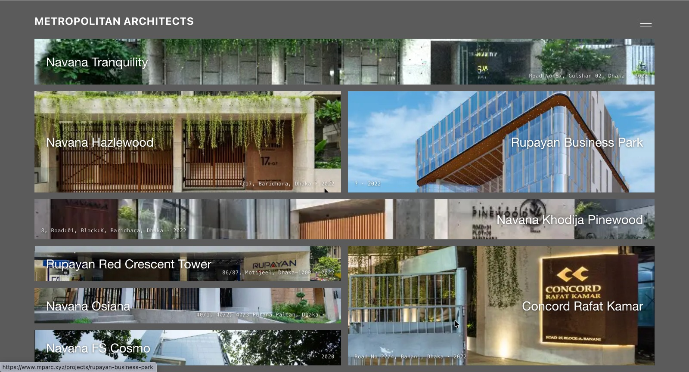

# MPA Website — Metropolitan Architects (Portfolio Website)

**Live Link:** [https://mparc.xyz/](https://mparc.xyz/)

## Overview

A modern **architecture firm portfolio website** for Metropolitan Architects (mparc.xyz), showcasing completed building projects in a dynamic, image-led grid.

## Technology

Laravel, Inertia.js, React.js; responsive design.

## Key Features (visible on the page)

- Mosaic/masonry-style project grid with large, full-bleed project photography.
- Each project card shows name, location, and year (e.g. Navana Tranquility, Rupayan Business Park, Concord Rafat Kamar).
- Minimal navigation with a hamburger menu.
- Project detail pages linked from each card (e.g. `/projects/rupayan-business-park`).
- Clean typography and overlay labels for a gallery-like experience.

## Capabilities Demonstrated

- Responsive, visual-first frontend development.
- Content/portfolio presentation for business and creative clients.

## Relevant Upwork Categories

Frontend / Website Development, Portfolio & Business Websites.

---
*Confirm client permission before sharing screenshots publicly.*
