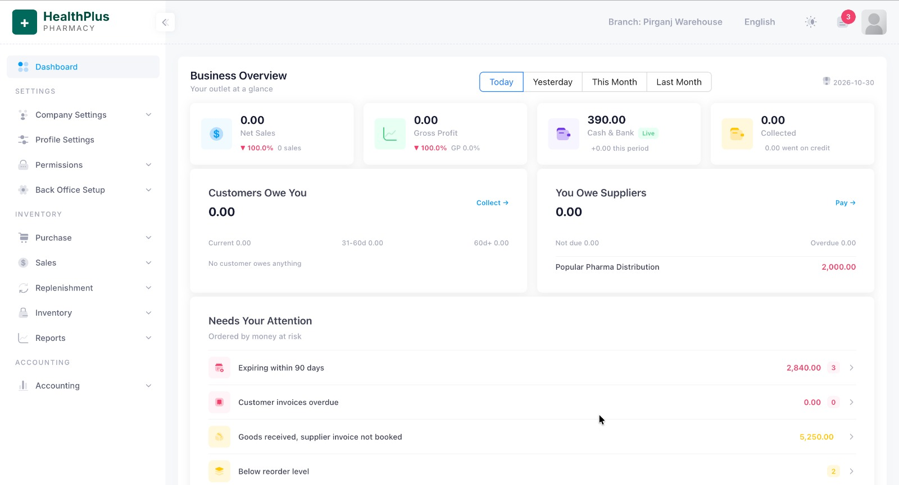
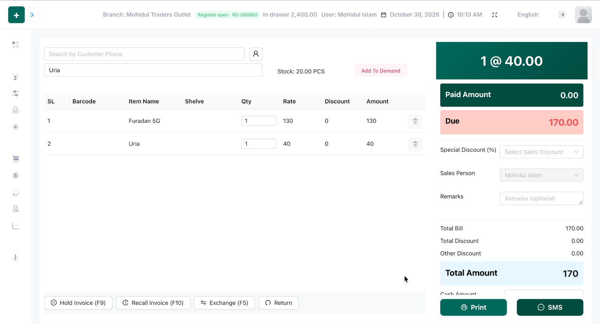

[← Back to Portfolio](../README.md)

# POS — HealthPlus Pharmacy (Point of Sale & Retail Management)

## Screenshots

**Dashboard — Business Overview**

**Sales Screen (POS UI)**

**Live Link:** Not available. This project is internally deployed and confidential, so it cannot be shared.

## Overview

A branch-aware **POS and retail/pharmacy management system** covering sales, purchasing, inventory, and accounting, with a fast keyboard-driven sales counter and a business-overview dashboard.

## Technology

Laravel, React.js, SQL databases.

## Key Features

### Dashboard
- Period filters: Today / Yesterday / This Month / Last Month.
- KPI cards: Net Sales, Gross Profit, Cash & Bank, Collected amount.
- Receivables ("Customers Owe You") with aging buckets and payables ("You Owe Suppliers").
- "Needs Your Attention" alerts: expiring stock (90 days), overdue customer invoices, goods received without supplier invoice, below reorder level.
- Sidebar: Company/Profile Settings, Permissions, Back Office Setup, Purchase, Sales, Replenishment, Inventory, Reports, Accounting.

### Sales Counter
- Customer search by phone, item search with live stock display, and "Add To Demand".
- Invoice line items with quantity, rate, discount, and amount.
- Hold Invoice (F9), Recall Invoice (F10), Exchange (F5), and Return.
- Special discount, sales person, remarks, paid/due calculation, Print and SMS.
- Branch and cash register status (drawer balance, user, date/time), multi-language (English) and light/dark theme.

## Capabilities Demonstrated

- Transaction validation and stock-consistent sales.
- Multi-branch operation, register/drawer handling.
- Reporting dashboards and receivable/payable tracking.

## Relevant Upwork Categories

POS & Retail Software, Laravel Development, React.js Development, ERP & Inventory.

---
*Confirm client permission before sharing screenshots publicly.*
