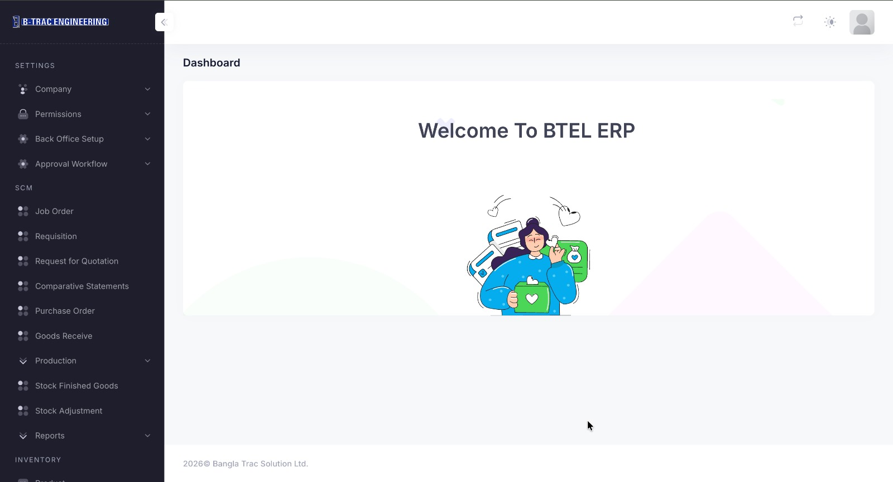

# SCM-ERP — BTEL ERP (Supply Chain & Inventory Management)

**Live Link:** Not available. This project is internally deployed and confidential, so it cannot be shared.

## Overview

BTEL ERP is an enterprise web application for **supply chain management (SCM)**, procurement, inventory, and production workflows, built for B-Trac Engineering. It digitizes the full procurement cycle, from job order and requisition to goods receiving and finished-goods stock, with configurable approval workflows and role-based permissions.

## Technology

Laravel (backend API), React.js (frontend), micro-service architecture, PostgreSQL.

## Key Modules (visible in the dashboard)

- **Settings:** Company, Permissions, Back Office Setup, Approval Workflow.
- **SCM:** Job Order, Requisition, Request for Quotation (RFQ), Comparative Statements, Purchase Order, Goods Receive.
- **Production:** Production management, Stock Finished Goods, Stock Adjustment.
- **Reports:** Operational and inventory reporting.
- **Inventory:** Product and stock management.

## Capabilities Demonstrated

- End-to-end procurement workflow (Requisition → RFQ → Comparative Statement → Purchase Order → GRN).
- Multi-level approval workflow and role-based access control.
- Warehouse stock, stock adjustment, and production-related inventory movements.
- Collapsible sidebar admin layout with light/dark theme toggle.

## Relevant Upwork Categories

ERP & Inventory, Laravel Development, Workflow Automation, Full-Stack Development.

---
*Confirm client permission before sharing screenshots publicly.*
