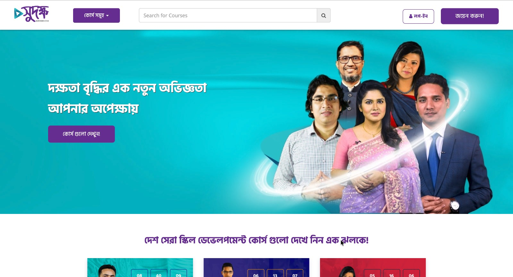

# Sudokhsho LMS — Online Learning Platform

**Live Link:** [https://sudoksho.com/](https://sudoksho.com/)

## Overview

**Sudokhsho** (সুদক্ষ) is a Bangla **Learning Management System (LMS)** for skill-development courses. Learners can browse, search, and enroll in courses, while administrators manage users, course content, and learning workflows.

## Technology

PHP / Laravel, JavaScript, relational database.

## Key Features (visible on the home page)

- Course catalog with a course-category dropdown and **course search**.
- Login and Sign-up (জয়েন করুন) flow for learners.
- Hero banner with a call-to-action to explore courses.
- Featured course cards with promotional/countdown-style badges.
- Bangla-language user interface.

## Capabilities Demonstrated

- Public-facing, content-driven education portal.
- User and role management, course and content management.
- Student and administrative workflows, assessment-related functionality.

## Relevant Upwork Categories

LMS / Education Portals, Laravel Development, Full-Stack Development.

---
*Confirm client permission before sharing screenshots publicly.*
